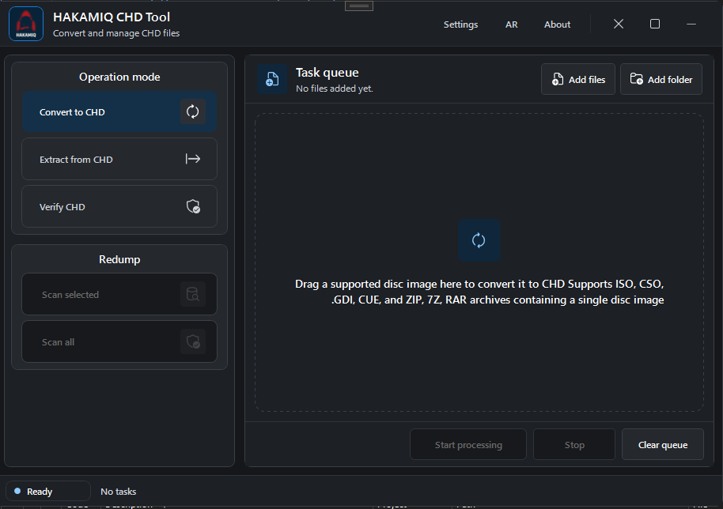

# CHD Tool

[](https://github.com/HAKAMIQ/HakamiqChdTool.App/releases/latest)
[](https://github.com/HAKAMIQ/HakamiqChdTool.App/actions/workflows/ci.yml)
[](LICENSE)


A Windows desktop app that converts disc images to CHD, verifies CHD files and
extracts them back, without typing `chdman` commands. The interface is
available in Arabic and English, with light and dark themes.



## Features

- **Convert to CHD** from ISO, CUE/BIN, GDI, TOC, CloneCD, Alcohol 120% (MDS/MDF),
  ECM, CSO, ZSO and raw
  hard-disk images, or from a ZIP, 7Z or RAR that holds one disc image.
- **Verify** existing CHD files, with optional Redump DAT matching that you
  provide.
- **Extract** CHD back to CUE/BIN (CD), GDI (Dreamcast GD-ROM), ISO (DVD) or IMG (hard disk).
- **Batch queue** with progress, cancel and retry for single files or whole
  folders.
- **Checks before work starts**: unreadable files, unsafe CUE paths, missing
  tracks, unsupported layouts and invalid output paths stop the job before any
  tool runs.
- **Library organizer** (optional): plans moves from DAT matches, never deletes
  files, and keeps a journal so every move can be undone.

## Download

Get the latest version from the
[Releases page](https://github.com/HAKAMIQ/HakamiqChdTool.App/releases/latest).

| Package | When to use it |
| --- | --- |
| `HakamiqChdTool-vX.Y.Z-win-x64-self-contained.zip` | **Recommended.** Includes the .NET 10 runtime; nothing else to install. |
| `HakamiqChdTool-vX.Y.Z-win-x64-runtime-required.zip` | Smaller. Needs the [.NET 10 Desktop Runtime x64](https://dotnet.microsoft.com/download/dotnet/10.0). |

Each package has a SHA-256 file next to it so you can check the download.

## Quick start

1. Extract the ZIP to a normal local folder, such as `C:\Tools\HakamiqChdTool`.
2. Run `HakamiqChdTool.exe`.
3. Choose **Convert to CHD**, **Extract from CHD** or **Verify CHD**.
4. Add files or a folder, or drag them onto the queue.
5. Pick an output folder and select **Start processing**.

Try one disc first so you can check the result before a large batch.

## Supported inputs

| Input | Convert | Notes |
| --- | :---: | --- |
| ISO | Yes | Converted as a DVD-type CHD; PS2 and PSP discs are recognized. |
| CUE/BIN | Yes | Add the `.cue`; every referenced `.bin` must be in the same folder. |
| GDI, TOC | Yes | Keep the descriptor and all track files together. |
| CloneCD (`.ccd`) | Yes | Converted through a temporary CUE; `.sub` subchannel data is not kept. |
| Alcohol 120% (`.mds`) | Yes | CD or DVD; add the `.mds`. Subchannel data is not kept. |
| ECM (`.bin.ecm`, `.img.ecm`) | Yes | Decoded and checked first; keep the `.cue` next to it. |
| CSO | Yes | Expanded to a temporary ISO first; the source is not changed. |
| ZSO | Yes | Needs the `ZISO` signature; also inside ZIP, 7Z and RAR. |
| Hard-disk image (`.img`, `.hdd`) | Yes | Only with the *Hard disk image* profile selected in Settings. |
| ZIP, 7Z, RAR | Yes | Must contain one supported disc image. |
| CHD | Verify / Extract | Not converted again. |
| NRG | Limited | Only where the workflow can handle it safely. |
| CDI | No | Rejected with a message. |
| PS3 | Detect only | Experimental; for information and verification. |

Full details: [Supported formats](docs/FORMATS.md).

## Requirements and limits

- Windows 10 (version 1809 or later) or Windows 11, x64.
- The bundled MAME `chdman` 0.289 needs a processor with x86-64-v2 support.
- Not every disc layout can be converted; the app tells you why before it
  starts.

## Bundled tools

| Tool | Version | Used for |
| --- | --- | --- |
| MAME `chdman` | 0.289 | Creating, verifying and extracting CHD |
| 7-Zip | 26.06 | Reading ZIP, 7Z and RAR |
| CsoKit | 0.6.6 | Expanding CSO and ZSO |
| igir (optional) | 5.8.1 | Read-only DAT reports for the library organizer |

Every bundled tool is pinned by SHA-256 and checked before use. Versions and
sources: [Tools/VERSIONS.md](Tools/VERSIONS.md).

## Documentation

- [User guide](docs/USER_GUIDE.md)
- [Supported formats](docs/FORMATS.md)
- [Conversion options](docs/CONV_OPTS.md)
- [Errors and logs](docs/ERRORS.md)
- [Changelog](docs/release-notes/CHANGELOG.md)
- [All documentation](docs/README.md)

## Security

Dependencies are locked and bundled tool hashes are pinned. Each release
includes a CycloneDX SBOM, SHA-256 hashes and GitHub build provenance
attestations. To report a vulnerability, see [SECURITY.md](SECURITY.md).

## Legal

CHD Tool does not include games, ROMs, BIOS files, disc images, Redump
databases, keys or firmware. Use it only with files you own or are allowed to
process. See the [legal notice](docs/legal/LEGAL.md) and
[third-party notices](docs/legal/3P_NOTICE.txt).

## Building from source

Requires the .NET SDK pinned in [`global.json`](global.json).

```powershell
dotnet restore .\HakamiqChdTool.App.csproj --locked-mode
dotnet build .\HakamiqChdTool.App.csproj -c Release --no-restore
```

Tests and local checks are described in [CONTRIBUTING.md](CONTRIBUTING.md).

## License

[MIT](LICENSE)
